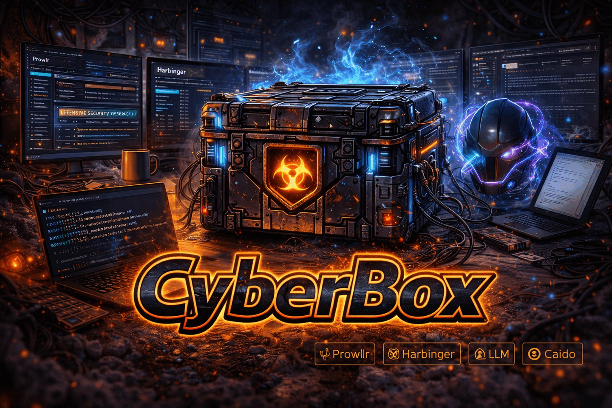

<p align="center">
  
</p>

<h1 align="center">CyberBox</h1>

<p align="center">
  A local Docker workstation for authorized security research.
</p>

<p align="center">
  <a href="https://github.com/ProwlrBot/CyberBox/releases/latest"></a>
  <a href="https://github.com/ProwlrBot/CyberBox/actions"></a>
  <a href="https://github.com/ProwlrBot/CyberBox/blob/main/LICENSE"></a>
</p>

CyberBox puts a browser, terminal, notebooks, code-server, security tools, and a
small control plane behind one local interface. It is designed for bug bounty,
web assessment, and lab work where scope and evidence need to remain visible.

The repository also contains:

- **Prowlr**, a Caido plugin for scoped request analysis and evidence export;
- **prowl**, the command-line research pipeline;
- **csbx**, the package and plugin manager;
- **invoke-claude** and **invoke-ollama**, matching command-line adapters for
  hosted and local models.

## Current status

CyberBox is usable as a local, single-user workstation. The control-plane API,
project profiles, ScopeGuard decisions, capability tokens, Plugin Center, and
paired Browser Hunt sessions are implemented. Several navigation areas in the
new React workspace are still previews, and the repository is not claiming
production multi-user isolation yet.

The exact gaps are tracked in [AUDIT.md](AUDIT.md) and [PLAN.md](PLAN.md). The
intended trust boundaries are documented in [THREAT_MODEL.md](THREAT_MODEL.md).

## Start the workstation

Requirements: Docker with the Compose plugin, `curl`, and a recent browser.

```bash
git clone https://github.com/ProwlrBot/CyberBox.git
cd CyberBox
./bin/cyberbox start
./bin/cyberbox status
```

Open <http://127.0.0.1:8080/>. The bind address and port can be changed with
`CYBERBOX_BIND` and `HOST_PORT`.

Useful commands:

```bash
./bin/cyberbox logs
./bin/cyberbox restart
./bin/cyberbox stop
./bin/cyberbox help
```

The default command pulls `ghcr.io/prowlrbot/cybersandbox:latest`. Contributors
who need a local image or custom mounts should follow
[cybersandbox/SETUP.md](cybersandbox/SETUP.md).

`./bin/cyberbox platform` starts the separate control-plane development setup.
It is not required for the main workstation.

## Browser Hunt

Browser Hunt runs two persistent browser sessions for authorization-boundary
testing. The attacker and victim roles have separate profiles, Docker volumes,
networks, and API keys.

```bash
./bin/cyberbox browser-hunt start
./bin/cyberbox browser-hunt connect
```

Sign-in remains a human step. After login, the browser state can be saved and
restored without putting a password, cookie, or recovery code in a model
prompt. Agents receive an expiring role lease instead of the browser API key.
Navigation, clicks, form fills, and evidence capture pass through the broker's
scope, pause, and approval checks.

The Browser Hunt page exposes both roles, takeover controls, saved identities,
scope, approvals, activity, and one-step Claude or Ollama runs. Evidence
redaction can be set to `Always`, `Evidence only`, or `Off`; infrastructure
credentials stay hidden in every mode.

See [the Browser Hunt guide](platform/docs/browser-hunt-bridge.md) for the CLI
contract and [the OpenShell note](platform/docs/openshell-browser-runtime.md)
for the optional NVIDIA OpenShell boundary.

## Command-line tools

```bash
export ANTHROPIC_API_KEY=sk-ant-...

./prowl/bin/prowl status
./prowl/bin/prowl hunt example.com
./prowl/bin/prowl pattern analyze_vulns < request.txt

./prowl/bin/invoke-claude --help
./prowl/bin/invoke-ollama --help
```

`prowl` is the primary pipeline name. `harbinger` is retained as a compatibility
alias for older scripts.

Manage optional tools with `csbx`:

```bash
csbx search xss
csbx install seclists
csbx install gf-patterns
csbx pdtm subfinder
csbx plan seclists
csbx plan --pdtm subfinder
csbx list
```

The community registry lives in
[ProwlrBot/csbx-registry](https://github.com/ProwlrBot/csbx-registry). CyberBox
validates the registry version and intake policy before replacing its local
copy. Standard plugins show whether their source is pinned. Caido entries use
the stricter signed-release path and are verified before extraction.

The Plugin Center shows the same resolved plan used by the CLI. It does not
install silently: the final command is handed to the terminal, where mutable
sources and install hooks still require confirmation. See the
[CSBX registry guide](cybersandbox/docs/csbx-registry.md) for the trust model
and non-interactive flags.

## Security model

The local defaults are intentionally conservative:

- published services bind to `127.0.0.1`;
- workspace users do not receive the Docker socket;
- active control-plane operations fail closed when scope is unknown;
- provider and plugin operations use short-lived, permission-specific tokens;
- browser roles use separate credentials and networks;
- original evidence is stored separately from redacted derivatives;
- model output is treated as an observation, not a confirmed finding.

Published images are built with an SBOM and provenance, scanned for critical
findings, and signed through the release workflow. Verify the digest before
using an image in a sensitive environment:

```bash
IMAGE=ghcr.io/prowlrbot/cybersandbox
DIGEST=$(docker buildx imagetools inspect "${IMAGE}:latest" --format '{{ .Manifest.Digest }}')

cosign verify "${IMAGE}@${DIGEST}" \
  --certificate-identity-regexp '^https://github.com/ProwlrBot/CyberBox/.github/workflows/cybersandbox-build.yml@refs/' \
  --certificate-oidc-issuer https://token.actions.githubusercontent.com
```

If verification fails, do not run the image. See [SECURITY.md](SECURITY.md) for
reporting instructions and the current security baseline.

## Repository map

```text
bin/                 CyberBox launcher and Browser Hunt broker
cybersandbox/        workstation image, runtime scripts, tests, and changelog
platform/backend/    FastAPI control plane
platform/frontend/   React workspace
platform/docs/       Browser Hunt and runtime notes
caido-plugin/        Prowlr Caido plugin
prowl/               pipeline, provider wrappers, patterns, and tests
openshell/           optional OpenShell policy template
plugins/scope-deck/  local target and scope research catalog
```

The high-level system design is in [ARCHITECTURE.md](ARCHITECTURE.md). Extension
contracts are documented in [PLUGIN_SDK.md](PLUGIN_SDK.md),
[PROVIDER_SDK.md](PROVIDER_SDK.md), and [WORKFLOW_SDK.md](WORKFLOW_SDK.md).

## Upstream and license

CyberBox began as a fork of
[agent-infra/sandbox](https://github.com/agent-infra/sandbox). The upstream
README is preserved in [UPSTREAM_README.md](UPSTREAM_README.md).

See [LICENSE](LICENSE) for license terms. Report security issues privately as
described in [SECURITY.md](SECURITY.md).
